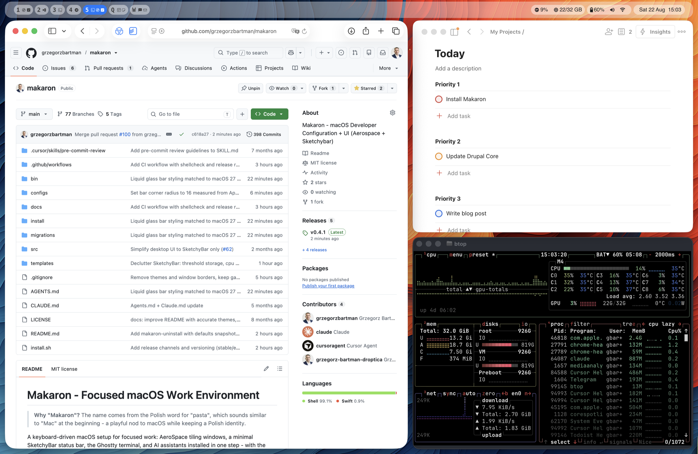

<p align="center">
  <picture>
    <source media="(prefers-color-scheme: dark)" srcset="assets/branding/makaron-logo-dark.svg">
    
  </picture>
</p>

<h1 align="center">Focused macOS Work Environment</h1>

<p align="center">
A keyboard-driven macOS setup for focused work: AeroSpace tiling windows, a minimal SketchyBar status bar,<br>
the Ghostty terminal, and AI assistants installed in one step - with the Dock and menu bar hidden<br>
so your screen holds only what you are working on.
</p>

> **Why "Makaron"?** The name comes from the Polish word for "pasta", which sounds similar to "Mac" at the beginning - a playful nod to macOS while keeping a Polish identity.



> [!NOTE]
> Makaron is an opinionated setup, but you don't need to fork it. Install it, follow the stable release channel, and customize it through override files in `~/.config/makaron/` that survive every update - see [Customizing Makaron](#customizing-makaron).

> [!TIP]
> No shortcuts to memorize: press `alt-shift-/` (that is: `?`) anytime to open the shortcut overlay - a floating panel listing every binding, generated live from your config. See [Keyboard Shortcuts](#keyboard-shortcuts).

## Perfect For

- **Keyboard-driven workers** - Switch, tile, and resize windows without touching the mouse
- **Deep-work setups** - Hidden Dock, hidden menu bar, one compact status bar
- **Terminal users** - Ghostty plus fast CLI tools (fzf, btop, lazygit)
- **Developers** - Optional group with containers and language tooling

## Requirements

- macOS
- Internet connection
- Admin access for Homebrew packages and system settings

## Quick Installation

```bash
curl -sL https://raw.githubusercontent.com/grzegorzbartman/makaron/main/install.sh | bash
```

After installation, reload your shell or open a new terminal.

## What Gets Installed

### UI & Window Management
- **AeroSpace** - Modern tiling window manager
- **SketchyBar** - Custom top status bar with a translucent, macOS-native look; the disk indicator stays hidden until usage crosses its alert threshold
- **Nerd Fonts** - Icon-capable fonts for the status bar and terminal

### Productivity Tools
- **Ghostty** - Fast, modern terminal emulator (configuration stays user-managed)
- **btop** - System resource monitor
- **Upsun CLI** - Upsun command-line tool

### Development Tools (optional)
- **Docker Desktop** - Container platform
- **DDEV** - Local PHP development environment
- **Composer** - PHP dependency manager
- **LazyDocker** - Terminal UI for Docker
- **LazyGit** - Terminal UI for Git
- **Node.js** - JavaScript runtime
- **pipx** - Python application installer

### System Configuration
- **macOS Settings** - System preferences tuned for tiling and distraction-free work
- **Migration System** - Safe, incremental configuration updates
- **User Config** - Personal settings in `~/.config/makaron/makaron.conf`

## Manual Installation

```bash
cd ~/projects
git clone https://github.com/grzegorzbartman/makaron.git
cd makaron
./install.sh
```

## Updates

To update your installation to the latest version:

```bash
makaron-update
```

This command will:
- Pull the latest changes from GitHub
- Run any pending migrations
- Reload configurations for the current UI mode

## Usage

### Available Commands

- **`makaron-update`** - Update to the latest release (`stable` channel, default) or latest `main` (`--edge`); `--stable`/`--edge` persist the choice
- **`makaron-version`** - Show installed version and update channel
- **`makaron-reload-aerospace-sketchybar`** - Reload AeroSpace + SketchyBar and re-apply layout
- **`makaron-reinstall`** - Complete reinstall from scratch
- **`makaron-migrate`** - Run pending migrations
- **`makaron-doctor`** - Concise health check with optional safe repairs (`--fix`, `--json`)
- **`makaron-ui-full`** - Start full UI (AeroSpace + SketchyBar, hidden Dock/menu bar)
- **`makaron-ui-stop`** - Stop UI components
- **`makaron-gaps <0-40>`** - Set persistent AeroSpace window gaps (for the active layout profile)
- **`makaron-gaps-zero`** - Set window gaps to zero
- **`makaron-gaps-toggle`** - Toggle gaps between zero and the last non-zero value (`alt-shift-g`)
- **`makaron-layout [auto|desktop|laptop]`** - Show or set the layout profile (see [Small screens](#small-screens))
- **`makaron-macos-config-reload`** - Apply macOS settings

### UI Modes

| Command | Components | Dock | Menu Bar | Layout |
|---|---|---|---|---|
| `makaron-ui-full` | AeroSpace + SketchyBar | Hidden | Hidden | configured gaps |
| `makaron-ui-stop` | Nothing | Visible | Visible | UI state not applied |

The default layout uses a `12px` gap. If the configured gap is `g`, a screen without a notch reserves `40 + g` pixels above windows for SketchyBar, while a notched built-in display uses `g`; external monitors always use `40 + g`. For example:

```bash
makaron-gaps 12
```

### Small screens

On a 13-inch MacBook Air, a 14-inch Pro at default scaling, or a MacBook Neo, side-by-side tiles get cramped and 12px gaps waste real estate. Makaron handles this with a **layout profile**:

| Profile | Gaps | Bar height | Accordion padding | When |
|---|---|---|---|---|
| `desktop` | `AEROSPACE_GAP_SIZE` (12) | `SKETCHYBAR_HEIGHT` (40) | `AEROSPACE_ACCORDION_PADDING` (30) | external monitor connected, or a wide built-in display |
| `laptop` | `AEROSPACE_GAP_SIZE_LAPTOP` (2) | `SKETCHYBAR_HEIGHT_LAPTOP` (32) | `AEROSPACE_ACCORDION_PADDING_LAPTOP` (12) | built-in display is the only screen and is narrower than 1600 pt |

`MAKARON_LAYOUT_PROFILE=auto` (default) picks the profile from the built-in display's size in points, not the model name, so Air 13 (1470 pt), Pro 14 (1512 pt) and Neo (1408 pt) get `laptop`, while "More Space" scaling, Air 15 and Pro 16 stay on `desktop`. Docking a monitor switches back to `desktop` on the fly. The laptop bar drops the floating look: it runs flat from edge to edge, flush with the top, and at 32 px fills the notch strip exactly, so windows lose no vertical space to it.

```bash
makaron-layout            # show the active profile and why
makaron-layout laptop     # force it (also: desktop, auto)
makaron-gaps 6            # sets the gap of the active profile
```

The laptop profile also caps side-by-side tiles: with `AEROSPACE_LAPTOP_MAX_TILES=2` (default) a third tiled window flips the workspace to the accordion layout, a stack where only the active window is visible and the others peek out by 12 px. Close a window and the workspace returns to tiles. Press `alt-slash` to tile by hand and Makaron leaves that workspace alone until it drops back under the limit. Set `0` to turn the guard off.

Workflow tips that work well on one small screen:
- Keep one app per workspace (`alt-1..0`) and treat workspaces as virtual monitors; tile only when two windows really belong side by side.
- `alt-m` makes the focused window fill the screen edge to edge (no outer gaps) and restores the tiling on the second press.
- `alt-shift-g` toggles gaps on and off without touching the config.
- `alt-comma` switches the workspace to the accordion layout (windows stacked almost full-width); `alt-slash` switches back.

### Manual Commands

- **Reload config**: `makaron-reload-aerospace-sketchybar`
- **macOS settings**: `makaron-macos-config-reload`

## Troubleshooting

If you encounter issues with your installation:

- **Quick health check**: `makaron-doctor`
- **Safe automatic repairs**: `makaron-doctor --fix`
- **Complete reinstall**: `makaron-reinstall`
- **Manual migration**: `makaron-migrate`

### Common Issues After Fresh Installation

**Problem: Commands `makaron-*` are not available in terminal**

After installation, reload your shell:

```bash
source ~/.zshrc
```

Or restart your terminal completely. If commands still do not work:

```bash
echo $PATH | grep makaron
echo 'export PATH="$HOME/.local/share/makaron/bin:$PATH"' >> ~/.zshrc
source ~/.zshrc
```

**Problem: Top bar or menu bar settings are wrong**

Makaron switches the menu bar through UI mode helpers:

```bash
makaron-ui-full
makaron-reload-aerospace-sketchybar
```

If macOS blocks the menu bar UI automation, open **System Settings > Control Center > Menu Bar** and set it manually.

**Problem: AeroSpace workspaces are not highlighted correctly**

Reload AeroSpace and SketchyBar:

```bash
aerospace reload-config
makaron-reload-aerospace-sketchybar
```

**Problem: Wrong workspaces after monitor changes**

```bash
sketchybar --reload
makaron-reload-aerospace-sketchybar
```

## Keyboard Shortcuts

Keyboard shortcuts are configured in `configs/aerospace/.aerospace.toml`.

Press `alt-shift-/` (that is: `?`) anytime to open the shortcut overlay - a floating glass panel listing every binding, generated live from your config so it always matches what is actually bound, including your own overrides. Close it with the close button, `esc`, or by pressing the shortcut again. You can also open it by clicking the M mark in the bar (right click opens the Makaron menu).

Highlights:
- `alt-1..0`, `alt-q/w` - Switch workspaces
- `alt-shift-1..0` - Move window to workspace
- `alt-enter` - New terminal window
- `alt-comma` / `alt-slash` - Accordion / tiled layout
- `alt-m` - Fullscreen (monocle, no outer gaps)
- `alt-shift-g` - Toggle window gaps on / off

## Modular Installation

The installation is modular. Core install flow:

```text
install/
├── all.sh              # Main orchestrator
├── mandatory.sh        # Core requirements
├── packages.sh         # Optional package selector
├── brew.sh             # Homebrew setup
├── desktop/            # AeroSpace, SketchyBar, fonts
├── terminal/           # Ghostty and terminal helpers
├── development/        # Languages, frameworks, dev tools
└── macos_settings.sh
```

## Files

- `configs/aerospace/.aerospace.toml` - AeroSpace config
- `configs/sketchybar/colors.sh` - SketchyBar color palette
- `configs/sketchybar/sketchybarrc` - SketchyBar status bar config
- `configs/sketchybar/plugins/` - SketchyBar plugin scripts
- `install/` - Modular installation scripts
- `migrations/` - Database-style migrations for configuration updates
- `templates/makaron.conf.default` - Default user configuration template
- `bin/` - Executable scripts

## Migration System

Makaron includes a migration system similar to database migrations. This allows safe, incremental updates to your configuration.

### How It Works

- Migrations are timestamped shell scripts in `migrations/`
- Each migration runs only once per installation
- State is tracked in `~/.local/state/makaron/migrations/`
- Migrations run automatically during `makaron-update`

## Customizing Makaron

Your overrides live in `~/.config/makaron/` and survive every update. Example templates (`*.example`) are seeded there on install - rename one to activate it, then apply with:

```bash
makaron-reload-aerospace-sketchybar
```

| File | What it overrides |
|---|---|
| `aerospace.user.toml` | Keybindings, app-to-workspace routing, float rules, any AeroSpace option |
| `colors.user.sh` | SketchyBar colors (bar, workspaces, focus highlight) |
| `sketchybar.user.sh` | Bar items: remove built-in widgets, add your own |
| `icons.user.sh` | Workspace app icons (Nerd Font glyphs) |

Examples:

```toml
# ~/.config/makaron/aerospace.user.toml
[mode.main.binding]
alt-enter = 'exec-and-forget open -na Ghostty'   # add a keybinding

[[on-window-detected]]                            # route an app (overrides base rules)
if.app-id = "com.spotify.client"
run = ["move-node-to-workspace 5"]
```

```bash
# ~/.config/makaron/colors.user.sh
export SPACE_FOCUSED_BACKGROUND_COLOR=0xffff375f  # change the focus color
```

Your AeroSpace keys win over the base config; your window rules run before Makaron's routing/float rules, written either as `[[on-window-detected]]` tables or as the `on-window-detected = [ {...} ]` array used in the current AeroSpace docs. The `[gaps]` block stays managed by `makaron-gaps`. A broken override file never breaks the desktop - Makaron falls back to the base config and `makaron-doctor` tells you why. Layout scalars live in `~/.config/makaron/makaron.conf` (`AEROSPACE_GAP_SIZE`, `SKETCHYBAR_HEIGHT`, `AEROSPACE_AUTO_DWINDLE`, `AEROSPACE_FOCUS_FOLLOWS_MOUSE`).

## Uninstall

```bash
makaron-uninstall
```

Stops the UI, restores macOS settings (from a snapshot taken at install time when available), removes symlinks, PATH entries, services, and Makaron itself. Optionally uninstalls the Homebrew packages Makaron installed - you choose. `--dry-run` shows the full plan first. Note: on setups installed before snapshotting existed, macOS settings revert to Apple factory defaults rather than your exact previous values.

## Releases and Update Channels

Makaron ships as tagged releases (`vX.Y.Z`). By default `makaron-update` follows the **stable** channel and resets to the latest release tag. Switch channels with:

```bash
makaron-update --edge     # follow latest main
makaron-update --stable   # back to releases
```

The choice is stored as `MAKARON_CHANNEL` in `~/.config/makaron/makaron.conf`.

### Creating Migrations

Create a new timestamped shell script in `migrations/` and make it executable:

```bash
chmod +x migrations/TIMESTAMP.sh
```

### Manual Migration

```bash
makaron-migrate
```

## User Configuration

Personal settings are stored in `~/.config/makaron/makaron.conf`. This file is created on install and preserved during updates. New variables added later get appended on update; existing values are never overwritten.

Available settings:

```bash
BATTERY_LOW_THRESHOLD=20                # Battery warning threshold (%)
SKETCHYBAR_COMPACT_MODE=false           # Hide CPU/memory/storage widgets on the right side
SKETCHYBAR_HIDE_EMPTY_WORKSPACES=false  # Hide empty, non-focused workspaces in the bar
AEROSPACE_GAP_SIZE=12                    # Window gap in pixels (0-40)
CPU_ALERT_THRESHOLD=80                   # CPU turns alert color above this usage (%)
MEMORY_ALERT_THRESHOLD=80                # Memory turns alert color above this usage (%)
STORAGE_ALERT_THRESHOLD=90               # Disk label turns alert color above this usage (%)
```

## Contributing

Contributions are welcome:

1. Fork the repository
2. Create a feature branch
3. Commit your changes
4. Push to the branch
5. Open a pull request

Please read [AGENTS.md](AGENTS.md) for development guidelines and code style.

## License

This project is licensed under the MIT License - see the [LICENSE](LICENSE) file for details.
